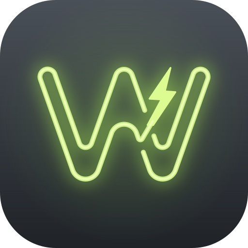
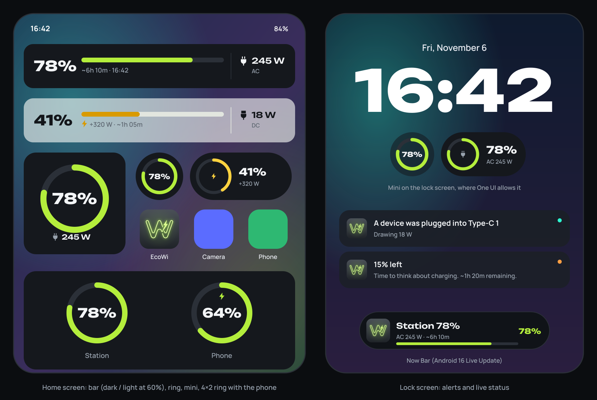
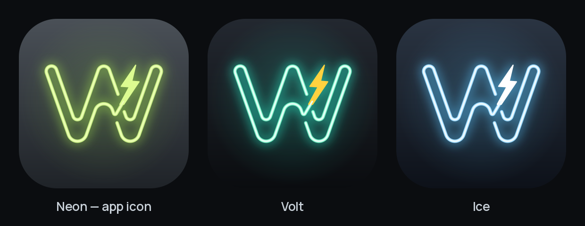

<p align="center">
  
</p>

<h1 align="center">EcoWi</h1>

<p align="center">
  Home-screen widgets, a lock-screen live status and the alerts the official app doesn't have,<br>
  for the <b>EcoFlow DELTA 3 Classic</b> portable power station.
</p>

<p align="center">
  <a href="LICENSE"></a>
  
  
  
</p>

<p align="center"><b>English</b> · <a href="README.uk.md">Українська</a></p>

> [!IMPORTANT]
> EcoWi is an **unofficial** community project. It is not affiliated with, endorsed by or supported by EcoFlow. It talks to EcoFlow's cloud the same way the official app does, so an EcoFlow update can break it at any time. See [Disclaimer](#disclaimer).



## Features

### Widgets

Every widget has its own theme (system / light / dark), background opacity (0–100 %) and wallpaper colours (Material You, Android 12+), independent of the phone's theme.

| Widget | Sizes | Shows |
|---|---|---|
| **Bar** | 5×1 (shrinks to 2×1, grows to 5×2) | Charge %, a coloured bar, time to empty / full, AC or DC load. Fits One UI widget stacks. |
| **Ring** | 2×2, 1×1, **4×2** | A circular charge gauge. At 4×2 it shows this phone's battery next to the station, like Samsung's Battery widget. |
| **Mini** | 1×1, 2×1 | A small ring or pill with the charge. Also offered as a lock-screen widget. |

- **AC / DC**: per widget, choose *AC first*, *DC first* or *Alternate* (switches every 3/5/8/12 s; done by the launcher itself, no background work).
- **Tap** a widget to refresh right away. Before the station is connected, a tap opens EcoWi.

### Alerts

Each can be turned on or off:

- **Low battery** at **15 %** and **5 %** (re-armed once the charge is 5 % above the threshold).
- **Fully charged**: 100 % or the charge limit set on the station.
- **Charging started** (at most once every 10 minutes, so a flickering grid doesn't spam you).
- **Grid power lost / restored**.
- **Device plugged in**: "A device was plugged into Type-C 1", "…into USB-A 2", "…into the AC output". Thresholds: USB / 12 V ≥ 3 W, AC ≥ 10 W. A port alerts again only after it has been idle for at least 2 minutes.

> The station reports its AC outlets as one combined value, so individual AC sockets can't be told apart. They share one "AC output" alert.

### Live mode

Keeps a connection to the station open, like the EcoFlow app does. Widgets update within ~10 s and alerts arrive within seconds. Runs as a foreground service with an ongoing notification; on **Android 16 / One UI 8** it is a **Live Update**, so the charge appears in the **Now Bar** and the status bar.

Without live mode, EcoWi checks the station in the background every 5/10/15/30/60 minutes.

## Status

Early stage. Things that are verified:

- 31 unit tests for the core logic (API signing, data mapping, DELTA 3 frame decoding, alert detection, AC/DC modes).
- The DELTA 3 frame decoder is tested against frames produced by Google's official protobuf runtime from the community protocol schema.
- The full Kotlin code, Compose UI included, compiles against the Android API 37 SDK and the real AndroidX/Compose libraries.

Not yet verified: running against a real DELTA 3 Classic. Start with **Test** on the *Connection* tab and look at the raw keys it shows. Reports are very welcome, see [SUPPORT.md](SUPPORT.md).

## Getting started

### Build

Requirements:

- Android Studio with support for AGP 9.4 (if Gradle sync reports an incompatible AGP version, update Android Studio)
- JDK 17

Versions used: AGP 9.4.0, Gradle 9.6.0, Kotlin 2.4.0, Compose BOM 2026.08.00, `compileSdk 37`, `targetSdk 36`, `minSdk 26`.

```bash
git clone https://github.com/FranciscoFrank/EcoWi.git
cd EcoWi
./gradlew assembleDebug        # or open the folder in Android Studio and press Run
./gradlew test                 # unit tests
```

Release builds are signed with the debug key so they are easy to sideload on your own phone; set up your own signing config before distributing.

What older Android versions get:

| Capability | Available on |
|---|---|
| Widgets, alerts, live mode | Android 8+ |
| Exact responsive widget sizes | Android 12+ (Android 8–11 picks a layout from the size reported by the launcher) |
| Wallpaper colours, system widget corner radius | Android 12+ |
| Notification permission prompt | Android 13+ (granted by default before) |
| Per-app language setting | Android 13+ |
| Live Update / Now Bar | Android 16+ |

### Connect your station

1. Open EcoWi → **Connection** → **EcoFlow account**.
2. Enter the e-mail and password you use in the EcoFlow app, and the station's serial number (EcoFlow app: station → ⚙ → About device, or the label on the unit).
3. Tap **Test**. It shows charge, AC, DC, input and every raw key received, without replacing your saved session.
4. Tap **Save**.
5. **Alerts** tab: allow notifications, optionally turn on **Live mode** and remove battery restrictions for EcoWi.

### Add widgets (One UI)

- **5-column grid**: One UI Home settings → *Home screen grid* → 5×5 or 5×6. On a 4-column grid the bar becomes 4×1.
- Long-press an empty spot → *Widgets* → **EcoWi** → *Bar*, *Ring* or *Mini*. The widget settings screen opens; One UI may skip it, in which case the defaults from the *Widgets* tab apply.
- **Stack**: drop a widget onto another widget of the same size, or long-press a stack → *Edit stack* → `+`.
- To change one widget: long-press it → *Settings*. *Apply to all widgets* on the *Widgets* tab copies the default look to every placed widget.

### Lock screen and the Battery widget

- Samsung's *Battery* widget can't be extended: One UI has no public API for it. The **4×2 Ring** (station + phone) is the replacement.
- **Mini** is declared as a lock-screen widget (`widgetCategory="keyguard"`). Whether it shows up depends on your One UI version; some builds only allow Samsung's own widgets there.
- The reliable option is the **Now Bar**: turn on live mode. If One UI still doesn't show EcoWi there, enable *Live notifications for all apps* in *Developer options*.

## How it works

The primary data source is **the same channel the EcoFlow app uses** (unofficial):

1. `POST https://api.ecoflow.com/auth/login` with your e-mail and password → token and `userId`. The session is reused for 7 days.
2. `GET /iot-auth/app/certification` → MQTT broker address and credentials.
3. MQTT: subscribe to `/app/device/property/{SN}` and `/app/{userId}/{SN}/thing/property/get_reply`; the full state is requested via `…/thing/property/get`.
4. The DELTA 3 sends binary protobuf frames (`HeaderMessage`; the payload is XOR-ed with the low byte of `seq`). They are decoded in `core/ecoflow/Delta3Codec.kt` using the field tables in `Delta3Fields.kt`: display (`cmd 254/21`), runtime (`254/22`) and BMS heartbeat (`3/x`).

Without live mode, EcoWi connects for a few seconds in the background, takes a snapshot and disconnects. In live mode the connection stays open, reconnects on failure and re-requests the full state every 5 minutes.

**Alternative**: the official **EcoFlow Developer API** (*Connection* → *Developer API*; keys from developer-eu.ecoflow.com; HMAC-SHA256 signed REST `quota/all`, then MQTT `/open/...`). The DELTA 3 Classic may not be supported there yet.

**If Test returns data but charge or watts stay empty**, expand *Show raw keys* and find what your station calls those fields. The names EcoWi looks for are in `core/QuotaMapper.kt` (`SOC`, `AC_OUT`, `PORT_KEYS`, `GRID_FLAG`, …; case and `_` are ignored). Unknown protobuf fields show up as `f<number>`.

Your password never leaves the phone except to EcoFlow's login endpoint. It is stored encrypted with AES-GCM using a key from the Android Keystore. EcoWi has no server of its own.

## Languages

English is the base language (`res/values`); Ukrainian is a full translation (`res/values-uk`). On Android 13+ the language can be chosen per app in system settings. Adding a language is described in [CONTRIBUTING.md](CONTRIBUTING.md#translations).

## Project structure

```
app/src/main/kotlin/ua/ecowi/
├── core/                  pure Kotlin, unit-tested
│   ├── PowerSnapshot.kt     station state (charge, ports, grid, limit…)
│   ├── QuotaMapper.kt       raw keys → PowerSnapshot
│   ├── LoadResolver.kt      AC/DC modes, charge bands, staleness
│   ├── StationEvents.kt     event detector for alerts
│   ├── EcoFlowSigner.kt     Developer API request signing
│   ├── proto/Proto.kt       minimal protobuf reader/writer
│   └── ecoflow/             DELTA 3 frame codec and field tables
├── data/
│   ├── EcoFlowAppApi.kt     account login, MQTT certificate
│   ├── AppMqtt.kt           app MQTT channel (snapshot and persistent connection)
│   ├── EcoFlowOpenApi.kt    Developer API (REST)
│   ├── OpenMqttSnapshot.kt  Developer API (MQTT)
│   ├── StationRepository.kt source selection, cache, alert dispatch
│   ├── Settings.kt          app and per-widget settings
│   └── SecureStore.kt       credential encryption
├── appwidget/             RemoteViews widgets (bar, ring, mini), palettes, rendering
├── notify/Notifier.kt     channels, event alerts, Live Update
├── live/LiveService.kt    live mode (foreground service) and restart after reboot
├── work/RefreshWork.kt    background refresh (WorkManager)
└── ui/                    Compose: "Volt" theme; Station / Widgets / Alerts / Connection tabs;
                           per-widget settings
tools/logo/                logo and launcher icon generator (Python)
tools/docs/                README images (mockups, logo variants)
```

## Logo

A vector redraw of a neon sign: one tube traces the outline of a bold "W", and a lightning bolt runs through two breaks in the right inner stroke, its tail merging into the tube. Geometry and colours were measured on the reference: tube `#C9EE85`, core `#EBFEB3`, bolt `#DCFB90`, background `#4A5057 → #1F2328`.



- `docs/ecowi_neon.svg` is the app icon; `docs/ecowi_volt.svg` and `docs/ecowi_ice.svg` are alternative palettes; `docs/ecowi_mark.svg` is the mark without a background.
- Everything comes from `tools/logo/` (shape in `geometry.py`, colours in `PALETTES` in `render.py`). `python tools/logo/render.py --install` rewrites the icons in `res/drawable` and the SVGs in `docs/`. VectorDrawable has no blur, so the in-app glow is built from layered translucent strokes.
- `python tools/docs/render_images.py` re-renders the README mockups (English and Ukrainian) and the variants sheet.

## Roadmap

- [ ] Detect which ports the station actually has (from telemetry and a per-model table) instead of a fixed list.
- [ ] Turn AC and USB outputs on and off from the app, a Quick Settings tile and the bar widget.
- [ ] Support more DELTA 3 family models.

Ideas and reports: [issues](https://github.com/FranciscoFrank/EcoWi/issues).

## Contributing

Contributions are welcome: code, translations, protocol findings and device reports. Read [CONTRIBUTING.md](CONTRIBUTING.md) first; commits follow [Conventional Commits](https://www.conventionalcommits.org/). Everyone taking part is expected to follow the [Code of Conduct](CODE_OF_CONDUCT.md).

- Help and questions: [SUPPORT.md](SUPPORT.md)
- Security issues: [SECURITY.md](SECURITY.md) (please don't open public issues for them)
- Changes: [CHANGELOG.md](CHANGELOG.md)

## License

EcoWi is released into the public domain under [The Unlicense](LICENSE): use, copy, modify and distribute it for any purpose, with no conditions.

Third-party parts keep their own licenses: the Unbounded and Manrope fonts (SIL Open Font License 1.1), the DELTA 3 protocol field mapping derived from hassio-ecoflow-cloud (Apache License 2.0) and the libraries the app links against. See [THIRD_PARTY_NOTICES.md](THIRD_PARTY_NOTICES.md).

## Disclaimer

- "EcoFlow" and "DELTA" are trademarks of their respective owner. EcoWi is an independent project and is not affiliated with, endorsed by or supported by EcoFlow.
- EcoWi uses unofficial interfaces. Using them may conflict with EcoFlow's terms of service in your region; you are responsible for how you use the app.
- The software is provided "as is", without warranty of any kind. Don't rely on it for safety-critical or medical equipment.

## Acknowledgements

- [tolwi/hassio-ecoflow-cloud](https://github.com/tolwi/hassio-ecoflow-cloud) for the community-documented EcoFlow protocols that made the DELTA 3 decoding possible.
- [Unbounded](https://github.com/googlefonts/unbounded) and [Manrope](https://github.com/googlefonts/manrope) typefaces.
