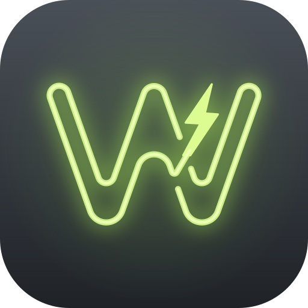
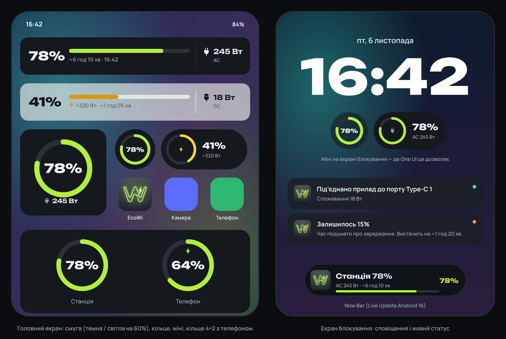
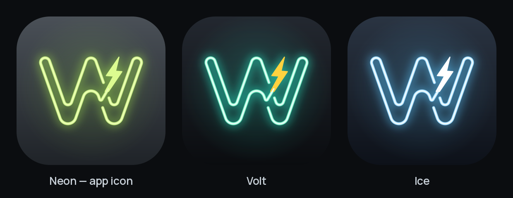

<p align="center">
  
</p>

<h1 align="center">EcoWi</h1>

<p align="center">
  Віджети для головного екрана, живий статус на екрані блокування і сповіщення, яких немає в офіційному застосунку,<br>
  для зарядних станцій <b>EcoFlow DELTA 3</b>.
</p>

<p align="center">
  <a href="https://github.com/FranciscoFrank/EcoWi/actions/workflows/ci.yml"></a>
  <a href="LICENSE"></a>
  
  
  
</p>

<p align="center">
  <a href="https://github.com/FranciscoFrank/EcoWi/releases/latest"><b>Завантажити APK</b></a> · <a href="https://franciscofrank.github.io/EcoWi/uk/">Сайт</a><br>
  <a href="README.md">English</a> · <b>Українська</b>
</p>

> [!IMPORTANT]
> EcoWi — **неофіційний** спільнотний проєкт. Він не пов’язаний з EcoFlow, не схвалений і не підтримується нею. Застосунок спілкується з хмарою EcoFlow так само, як офіційний застосунок, тому будь-яке оновлення EcoFlow може його зламати. Див. [Застереження](#застереження).
>
> Основна мова проєкту — англійська; цей файл є перекладом [README.md](README.md).



## Можливості

### Віджети

У кожного віджета своя тема (як у системі / світла / темна), прозорість фону (0–100 %) і кольори зі шпалер (Material You, Android 12+), незалежно від теми телефона.

| Віджет | Розміри | Що показує |
|---|---|---|
| **Смуга** | 5×1 (стискається до 2×1, розтягується до 5×2) | Відсотки, кольорова смуга, час до розряду / повного заряду, навантаження AC або DC. Підходить для стеків One UI. |
| **Кільце** | 2×2, 1×1, **4×2** | Кругла діаграма заряду. У розмірі 4×2 поруч показує заряд цього телефона, як віджет Samsung «Акумулятор». |
| **Міні** | 1×1, 2×1 | Маленьке кільце або «пігулка» з відсотками. Також доступний як віджет для екрана блокування. |

- **AC / DC**: для кожного віджета окремо — «Спершу AC», «Спершу DC» або «По черзі» (перемикання кожні 3/5/8/12 с; це робить сам лаунчер, без фонових задач).
- **Дотик** до віджета одразу оновлює дані. Поки станцію не під’єднано, дотик відкриває EcoWi.
- Відсотки набрано шрифтом **Unbounded**, як і в попередньому перегляді в застосунку. Лаунчери не підвантажують шрифти застосунку у віджетах, тож EcoWi малює відсотки зображенням; решта тексту віджета — системним шрифтом.

### Сповіщення

Кожне вмикається окремо:

- **Низький заряд**: **15 %** і **5 %** (спрацьовує повторно, коли заряд підніметься на 5 % вище порогу).
- **Повний заряд**: 100 % або ліміт заряду, встановлений на станції.
- **Почалося заряджання** (не частіше ніж раз на 10 хв, щоб «блимання» мережі не спамило).
- **Мережа зникла / з’явилася**.
- **Станція не відповідає**: коли станція перестає відповідати (вимкнена, заснула, без Wi-Fi) і коли знову на зв’язку. Див. [Коли станція не відповідає](#коли-станція-не-відповідає).
- **Під’єднано прилад**: «Під’єднано прилад до порту Type-C 1», «…до порту USB-A 2», «…до виходу AC». Пороги: USB / 12 В ≥ 3 Вт, AC ≥ 10 Вт. Повторне сповіщення по тому ж порту приходить, лише якщо він простоював щонайменше 2 хв.

> Розетки AC станція звітує одним спільним значенням, тому окремі розетки розрізнити неможливо: для них приходить одне сповіщення «до виходу AC».

### Живий режим

Тримає з’єднання зі станцією відкритим, як застосунок EcoFlow. Віджети оновлюються за ~10 с, сповіщення приходять за кілька секунд. Працює як foreground service з постійним сповіщенням; на **Android 16 / One UI 8** це **Live Update**, тож заряд видно в **Now Bar** і в рядку стану.

Без живого режиму EcoWi перевіряє станцію у фоні кожні 5/10/15/30/60 хв.

### Порти твоєї моделі

EcoWi показує лише ті порти, що є у твоїй станції. Таблиця моделей DELTA 3 (`core/StationModels.kt`) містить роз’єми кожної моделі, а кількість розеток AC залежить від регіону (230 В чи 120 В). З Developer API модель визначається з хмари EcoFlow; інакше вибери її в «Зв’язок» → «Модель станції». Порт, на якому є навантаження, з’явиться, навіть якщо в таблиці його немає.

| Станція | Розетки AC, 230 В / 120 В | Інші порти, що показуються | Розкладка портів |
|---|---|---|---|
| DELTA 3 Classic | 2 / 3 | USB-A, 2 × USB-C | перевірено на станції |
| DELTA 3, DELTA 3 Plus, DELTA 3 1500 | 4 / 6 | 2 × USB-A, 2 × USB-C, 12 В | за специфікацією |
| DELTA 3 Max Plus | 4 / 4 | USB-A, 2 × USB-C, 12 В | за специфікацією |

У твоїй станції інші порти або в тебе інша модель? Створи [звіт про станцію](https://github.com/FranciscoFrank/EcoWi/issues/new?template=station_report.md); як додати модель, описано в [CONTRIBUTING.md](CONTRIBUTING.md#station-models).

## Стан проєкту

Рання стадія. Що перевірено:

- 53 юніт-тести базової логіки (підпис API, мапінг даних, розбір кадрів DELTA 3, виявлення подій і зникнення зв’язку, моделі станцій і порти, режими AC/DC, залишок часу).
- Декодер кадрів DELTA 3 перевірено на кадрах, згенерованих офіційною protobuf-бібліотекою Google за спільнотною схемою протоколу.
- Увесь Kotlin-код, включно з Compose-інтерфейсом, компілюється проти Android SDK API 37 і справжніх бібліотек AndroidX/Compose, а [CI](https://github.com/FranciscoFrank/EcoWi/actions/workflows/ci.yml) збирає й тестує кожен push.

EcoWi розробляється на DELTA 3 Classic. Інші моделі DELTA 3 ще не пробували: почни з **«Перевірити»** на вкладці «Зв’язок» і поглянь на сирі ключі. Звіти дуже вітаються, див. [SUPPORT.md](SUPPORT.md).

## Початок роботи

### Встановлення

Завантаж APK з [останнього випуску](https://github.com/FranciscoFrank/EcoWi/releases/latest), відкрий його на телефоні й дозволь браузеру встановлювати застосунки, коли Android запитає. До кожного випуску додано `SHA256SUMS.txt`, щоб перевірити файл.

Якщо в тебе стоїть збірка з Android Studio, спершу видали її: вона підписана твоїм власним debug-ключем, а Android не оновить застосунок версією з іншим підписом.

### Збірка

Потрібно:

- Android Studio з підтримкою AGP 9.4 (якщо Gradle Sync скаже, що версія AGP несумісна, онови Android Studio)
- JDK 17 або новіший, щоб запустити Gradle. Сам демон Gradle працює на JDK 25 (`gradle/gradle-daemon-jvm.properties`), і Gradle завантажить його, якщо його немає.

Версії: AGP 9.4.0, Gradle 9.6.0, Kotlin 2.4.0, Compose BOM 2026.08.00, `compileSdk 37`, `targetSdk 36`, `minSdk 26`.

```bash
git clone https://github.com/FranciscoFrank/EcoWi.git
cd EcoWi
./gradlew assembleDebug        # або відкрий теку в Android Studio і натисни Run
./gradlew test                 # юніт-тести
```

`assembleRelease` підписує твоїм keystore, якщо задано `ECOWI_KEYSTORE` і пов’язані параметри, у змінних середовища або в `~/.gradle/gradle.properties` (див. [CONTRIBUTING.md](CONTRIBUTING.md#releasing)). Без них використовується debug-ключ, чого досить для власного телефона.

Що отримують старіші версії Android:

| Можливість | Доступно з |
|---|---|
| Віджети, сповіщення, живий режим | Android 8+ |
| Точне підлаштування віджета під розмір | Android 12+ (на 8–11 макет вибирається за розміром, який повідомив лаунчер) |
| Кольори зі шпалер, системний радіус кутів віджета | Android 12+ |
| Запит дозволу на сповіщення | Android 13+ (раніше дозвіл є одразу) |
| Мова окремо для застосунку | Android 13+ |
| Live Update / Now Bar | Android 16+ |

### Під’єднання станції

1. Відкрий EcoWi → **«Зв’язок»** → **«Акаунт EcoFlow»**.
2. Введи пошту й пароль від застосунку EcoFlow і серійний номер станції (застосунок EcoFlow: станція → ⚙ → Про пристрій, або наліпка на корпусі).
3. Натисни **«Перевірити»**. Тест покаже заряд, AC, DC, вхід і всі отримані сирі ключі, не замінюючи збережену сесію.
4. Натисни **«Зберегти»**.
5. **«Модель станції»**: залиш «Автоматично» (потрібен Developer API) або вибери свою станцію, щоб показувалися лише її порти.
6. Вкладка **«Сповіщення»**: дозволь сповіщення, за бажанням увімкни **живий режим** і зніми обмеження батареї для EcoWi.

### Віджети на екрані (One UI)

- **Сітка з 5 стовпців**: параметри One UI Home → «Сітка головного екрана» → 5×5 або 5×6. На сітці з 4 стовпців смуга стане 4×1.
- Довге натискання на порожньому місці → «Віджети» → **EcoWi** → «Смуга», «Кільце» або «Міні». Відкриються налаштування віджета; One UI може їх пропустити — тоді діють налаштування з вкладки «Віджети».
- **Стек**: перетягни віджет на інший такого ж розміру або довге натискання на стек → «Редагувати стек» → `+`.
- Змінити окремий віджет: довге натискання → «Налаштування». Кнопка «Застосувати до всіх віджетів» на вкладці «Віджети» переносить вигляд за замовчуванням на всі вже додані віджети.

### Екран блокування і віджет «Акумулятор»

- Розширити віджет Samsung «Акумулятор» неможливо: в One UI немає для цього публічного API. Заміна — **Кільце 4×2** (станція + телефон).
- **Міні** оголошений як віджет для екрана блокування (`widgetCategory="keyguard"`). Чи з’явиться він у списку, залежить від версії One UI: частина прошивок пускає туди лише віджети Samsung.
- Надійний варіант — **Now Bar**: увімкни живий режим. Якщо One UI все одно не показує EcoWi, в «Параметрах розробника» увімкни «Живі сповіщення для всіх застосунків».

## Як це працює

Основне джерело даних — **той самий канал, що й у застосунку EcoFlow** (неофіційний):

1. `POST https://api.ecoflow.com/auth/login` з поштою й паролем → токен і `userId`. Сесія використовується 7 днів.
2. `GET /iot-auth/app/certification` → адреса MQTT-брокера й облікові дані.
3. MQTT: підписка на `/app/device/property/{SN}` і `/app/{userId}/{SN}/thing/property/get_reply`; повний стан запитується через `…/thing/property/get`.
4. DELTA 3 надсилає бінарні protobuf-кадри (`HeaderMessage`; payload XOR-ується молодшим байтом `seq`). Їх розбирає `core/ecoflow/Delta3Codec.kt` за таблицями полів із `Delta3Fields.kt`: екран (`cmd 254/21`), runtime (`254/22`) і heartbeat BMS (`3/x`).

Без живого режиму EcoWi у фоні підключається на кілька секунд, бере знімок стану і відключається. У живому режимі з’єднання тримається постійно, поновлюється при обриві, а повний стан перезапитується кожні 5 хв.

### Коли станція не відповідає

Сигналу «станцію вимкнули» не існує, тож EcoWi робить висновок сам. Оновлення, яке дійшло до хмари EcoFlow, але не отримало нічого від станції, вважається *тихим*. Після двох тихих перевірок, між якими минуло щонайменше 3 хв, або одразу, якщо Developer API каже, що станція офлайн, приходить сповіщення «Станція не відповідає», а віджети показують «Немає відповіді» з часом останніх даних. Коли дані знову надходять, сповіщення «Станція знову на зв’язку» каже, скільки її не було.

- **Живий режим**: після 90 с без даних станцію ще раз просять надіслати повний стан, тож сповіщення приходить приблизно за 3–4 хв після того, як вона замовкла.
- **Періодичне оновлення**: після першої тихої перевірки EcoWi перевіряє ще раз за 3 хв, а не чекає наступного інтервалу.
- Проблеми на боці телефона (немає інтернету, сесія застаріла) ніколи не вважаються вимкненням станції.

Логіка — у `core/StationLink.kt`, з власними тестами.

**Альтернатива** — офіційний **EcoFlow Developer API** («Зв’язок» → «Developer API»; ключі з developer-eu.ecoflow.com; REST `quota/all` з підписом HMAC-SHA256, потім MQTT `/open/...`). DELTA 3 Classic там може бути ще не підтримана.

**Якщо «Перевірити» показує дані, але відсотки чи вати порожні**, розгорни «Показати сирі ключі» і знайди, як твоя станція називає ці поля. Назви, які шукає EcoWi, зібрані в `core/QuotaMapper.kt` (`SOC`, `AC_OUT`, `PORT_KEYS`, `GRID_FLAG` …; регістр і `_` ігноруються). Невідомі protobuf-поля з’являються як `f<номер>`.

Пароль не залишає телефон, окрім запиту на вхід до EcoFlow. Він зберігається зашифрованим AES-GCM ключем з Android Keystore. Власного сервера в EcoWi немає.

## Мови

Основна мова — англійська (`res/values`), українська — повний переклад (`res/values-uk`). На Android 13+ мову можна вибрати окремо для застосунку в налаштуваннях системи. Як додати мову, описано в [CONTRIBUTING.md](CONTRIBUTING.md#translations).

## Структура

```
app/src/main/kotlin/ua/ecowi/
├── core/                  чистий Kotlin, покритий тестами
│   ├── PowerSnapshot.kt     стан станції (заряд, порти, мережа, ліміт…)
│   ├── QuotaMapper.kt       сирі ключі → PowerSnapshot
│   ├── LoadResolver.kt      режими AC/DC, рівні заряду, «застарілість»
│   ├── StationEvents.kt     детектор подій для сповіщень
│   ├── StationModels.kt     моделі DELTA 3, їхні порти, порти з телеметрії
│   ├── StationLink.kt       виявлення «станція не відповідає»
│   ├── Durations.kt         округлення залишку часу
│   ├── EcoFlowSigner.kt     підпис Developer API
│   ├── proto/Proto.kt       мінімальний protobuf reader/writer
│   └── ecoflow/             кодек кадрів DELTA 3 і таблиці полів
├── data/
│   ├── EcoFlowAppApi.kt     вхід в акаунт, сертифікат MQTT
│   ├── AppMqtt.kt           MQTT-канал застосунку (знімок і постійне з’єднання)
│   ├── EcoFlowOpenApi.kt    Developer API (REST)
│   ├── OpenMqttSnapshot.kt  Developer API (MQTT)
│   ├── StationRepository.kt вибір джерела, кеш, запуск сповіщень
│   ├── Settings.kt          налаштування застосунку і кожного віджета
│   ├── SecureStore.kt       шифрування облікових даних
│   └── Net.kt               перевірка зв’язку телефона
├── appwidget/             віджети на RemoteViews (смуга, кільце, міні), палітри, рендер
├── notify/Notifier.kt     канали, сповіщення про події, Live Update
├── live/LiveService.kt    живий режим (foreground service) і запуск після перезавантаження
├── work/RefreshWork.kt    фонове оновлення (WorkManager)
└── ui/                    Compose: тема «Neon»; вкладки Станція / Віджети / Сповіщення / Зв’язок;
                           налаштування окремого віджета
tools/logo/                генератор логотипа та іконок (Python)
tools/docs/                зображення для README (макети, варіанти логотипа, палітра)
tools/fonts/               прев’ю відсотків для списку віджетів (гліфи → VectorDrawable)
tools/site/                збирає сайт із site/
site/                      шаблон сайту (GitHub Pages)
.github/workflows/         CI, випуски, публікація сайту
```

## Логотип

Векторна перемальовка неонової вивіски: одна трубка обводить контур товстої «W», а через два розриви в правому внутрішньому штриху проходить блискавка, хвіст якої переходить у трубку. Геометрію й кольори виміряно на референсі: трубка `#C9EE85`, ядро `#EBFEB3`, блискавка `#DCFB90`, фон `#4A5057 → #1F2328`. З тих самих кольорів складається палітра застосунку **Neon**; повна палітра, шрифти і де лежить кожне значення — у [docs/BRAND.md](docs/BRAND.md).



- `docs/ecowi_neon.svg` — іконка застосунку; `docs/ecowi_volt.svg` і `docs/ecowi_ice.svg` — інші палітри; `docs/ecowi_mark.svg` — знак без фону.
- Усе генерується з `tools/logo/` (форма в `geometry.py`, кольори в `PALETTES` у `render.py`). `python tools/logo/render.py --install` перезаписує іконки в `res/drawable` і SVG у `docs/`. У VectorDrawable немає розмиття, тож світіння в застосунку зібране з кількох напівпрозорих штрихів.
- `python tools/docs/render_images.py` перегенеровує макети для README (англійський і український) і аркуш варіантів логотипа.

## Плани

- [x] Визначати, які порти реально є в станції (таблиця моделей плюс телеметрія), замість фіксованого списку.
- [ ] Визначати модель і через канал акаунта EcoFlow (зараз її повідомляє лише Developer API).
- [ ] Вмикати й вимикати виходи AC і USB із застосунку, плитки швидких налаштувань і віджета-смуги.
- [ ] Підтримка інших моделей серії DELTA 3.

Ідеї та звіти: [issues](https://github.com/FranciscoFrank/EcoWi/issues).

## Участь у розробці

Внески вітаються: код, переклади, знахідки щодо протоколу і звіти з пристроїв. Спершу прочитай [CONTRIBUTING.md](CONTRIBUTING.md); коміти мають відповідати [Conventional Commits](https://www.conventionalcommits.org/). Від усіх учасників очікується дотримання [Кодексу поведінки](CODE_OF_CONDUCT.md).

- Допомога і питання: [SUPPORT.md](SUPPORT.md)
- Проблеми безпеки: [SECURITY.md](SECURITY.md) (будь ласка, не відкривай для них публічні issues)
- Зміни: [CHANGELOG.md](CHANGELOG.md)
- Випуски й сайт: [CONTRIBUTING.md](CONTRIBUTING.md#releasing)

## Ліцензія

EcoWi передано в суспільне надбання за [The Unlicense](LICENSE): використовуй, копіюй, змінюй і поширюй для будь-яких цілей без жодних умов.

Сторонні частини зберігають власні ліцензії: шрифти Unbounded і Manrope (SIL Open Font License 1.1), мапінг полів протоколу DELTA 3 на основі hassio-ecoflow-cloud (Apache License 2.0) і бібліотеки, з якими зібрано застосунок. Див. [THIRD_PARTY_NOTICES.md](THIRD_PARTY_NOTICES.md).

## Застереження

- «EcoFlow» і «DELTA» є торговими марками відповідного власника. EcoWi — незалежний проєкт, не пов’язаний з EcoFlow, не схвалений і не підтримуваний нею.
- EcoWi використовує неофіційні інтерфейси. Це може суперечити умовам користування EcoFlow у твоєму регіоні; відповідальність за використання застосунку лежить на тобі.
- Програмне забезпечення надається «як є», без будь-яких гарантій. Не покладайся на нього для живлення критично важливого чи медичного обладнання.

## Подяки

- [tolwi/hassio-ecoflow-cloud](https://github.com/tolwi/hassio-ecoflow-cloud) — за задокументовані спільнотою протоколи EcoFlow, без яких розбір DELTA 3 був би неможливим.
- Шрифти [Unbounded](https://github.com/googlefonts/unbounded) і [Manrope](https://github.com/googlefonts/manrope).
