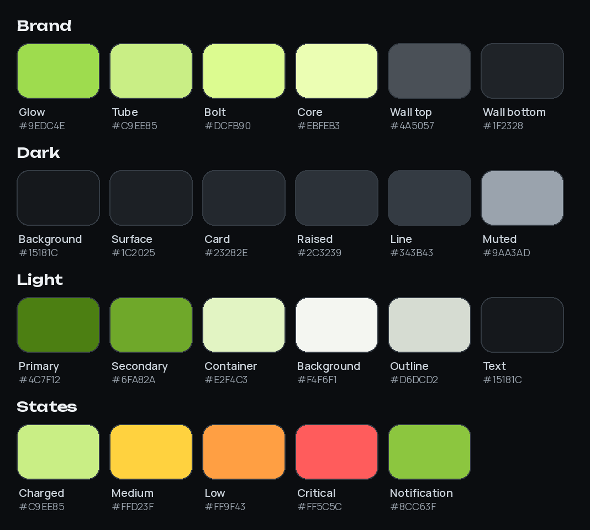

# EcoWi brand guide

One palette, taken from the logo, is used everywhere: the app, the widgets, notifications and the icon.

## Colours

### Brand (the neon tube and its wall)

| Token | Hex | Used for |
|---|---|---|
| Glow | `#9EDC4E` | Start of the energy gradient, icon glow, secondary accent |
| Tube | `#C9EE85` | Primary accent on dark, "charged" battery band, widget accent |
| Bolt | `#DCFB90` | End of the energy gradient, charging bolt |
| Core | `#EBFEB3` | Bright highlight inside the tube (icon only) |
| Wall top / bottom | `#4A5057` → `#1F2328` | Icon background; *Wall bottom* is also the dark widget card |

### Dark theme

| Token | Hex |
|---|---|
| Background | `#15181C` |
| Surface | `#1C2025` |
| Card | `#23282E` |
| Raised | `#2C3239` |
| Line (outline) | `#343B43` |
| Text / muted text | `#EEF1F4` / `#9AA3AD` |

### Light theme

The tube colour is too pale on white, so the light theme uses darker leaf greens from the same hue.

| Token | Hex |
|---|---|
| Primary | `#4C7F12` |
| Secondary | `#6FA82A` |
| Primary container | `#E2F4C3` |
| Background / surface | `#F4F6F1` / `#FFFFFF` |
| Outline | `#D6DCD2` |
| Text / muted text | `#15181C` / `#5D6670` |

### States

| Battery band | Dark | Light |
|---|---|---|
| Charged (> 50 %) | `#C9EE85` | `#4C8A12` |
| Medium (26–50 %) | `#FFD23F` | `#C98F00` |
| Low (11–25 %) | `#FF9F43` | `#E36A00` |
| Critical (≤ 10 %) | `#FF5C5C` | `#D32F2F` |

Notifications use `#8CC63F` for the small icon and app name, a middle green that stays readable on light and dark notification shades.

## Typography

- **Unbounded** (SemiBold, ExtraBold): numbers and headlines, including the charge percentage on widgets.
- **Manrope** (Regular, SemiBold, Bold): everything else in the app.
- **Widgets**: launchers don't load app fonts for widgets, so widget text uses the system font. The percentage is the exception: EcoWi draws it in Unbounded itself (`appwidget/SocText.kt`), and the widget-picker previews use a vector made from the Unbounded glyphs (`tools/fonts/preview_text.py`).

## Where the values live

Change a colour in all of these places together:

| File | What |
|---|---|
| `app/src/main/kotlin/ua/ecowi/ui/theme/Theme.kt` | `Neon` object, Material colour schemes, `WidgetType` (preview text styles) |
| `app/src/main/res/values/colors.xml` | Widget palettes, battery bands, notification accent |
| `tools/logo/render.py` | `PALETTES["neon"]`, the app icon |
| `tools/docs/render_images.py` | Mockup palettes and this page's swatch sheet |

Then regenerate the assets: `python tools/logo/render.py --install` and `python tools/docs/render_images.py`.

## Logo

- `docs/ecowi_neon.svg` is the logo; `docs/ecowi_mark.svg` is the mark without a background.
- Keep the wall background or put the mark on a dark surface (`#1F2328` or darker). On light backgrounds the pale tube loses contrast.
- `docs/ecowi_volt.svg` and `docs/ecowi_ice.svg` are alternative palettes for experiments. The app doesn't use them.
